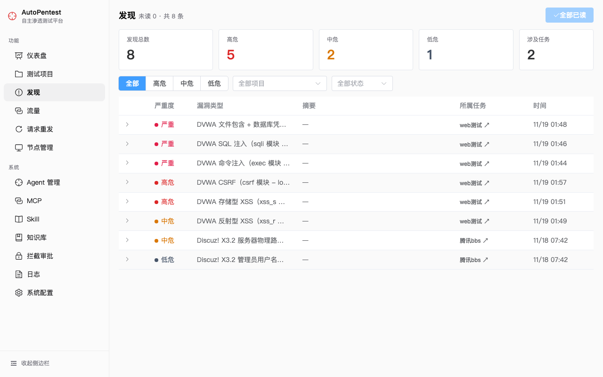
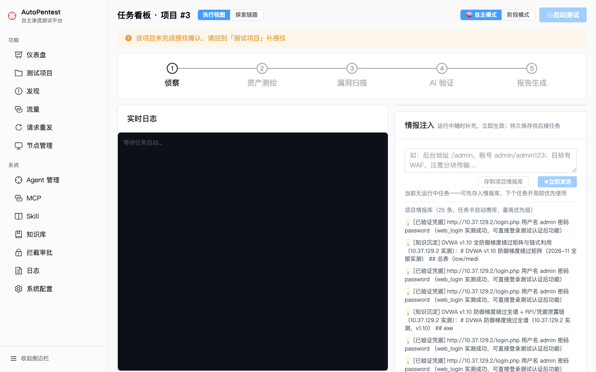
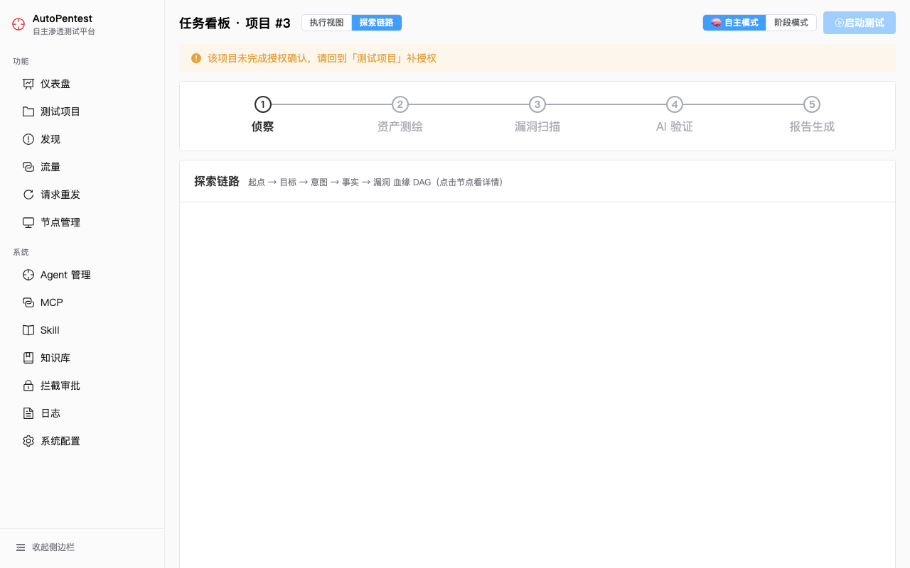
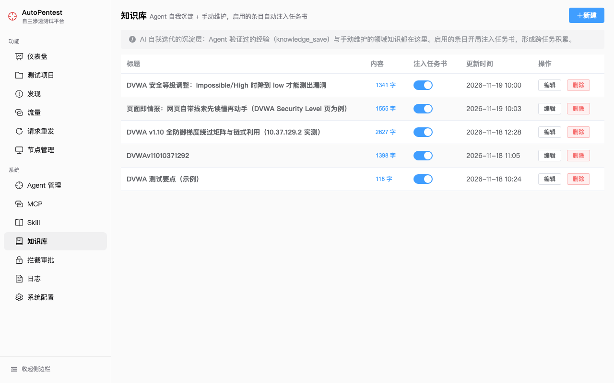

# Argus — 自主渗透测试平台（Go 重构版）

[English](README_EN.md) | 中文

AutoPentest 的 Go 重构：**单二进制 + 分布式节点架构**。LLM Agent 自主编排「侦察 → 资产测绘 → 漏洞扫描 → AI 验证 → 报告」全流程，支持 FOFA 空间测绘、知识自我迭代、AIMD 自适应限速等完整能力。

> ⚠️ **仅限对已获书面授权的目标使用。** 内置范围护栏（ScopeGuard）与全量审计，范围外请求强制拦截。使用前请阅读[免责声明](#免责声明)。

## 界面预览

| 发现页：漏洞条目 + 展开即证据 | 任务看板：实时日志 + 决策树 + 情报注入 |
|---|---|
|  |  |

| 探索链路：血缘 DAG | 知识库：Agent 经验自动沉淀 |
|---|---|
|  |  |

## 快速开始

```bash
# 构建（Go ≥ 1.22）
go build -o argus-server ./cmd/argus-server
go build -o argus-node   ./cmd/argus-node

# 启动管理面（API + UI + SQLite，默认 :7887）
./argus-server

# 浏览器打开 http://127.0.0.1:7887
```

### 节点接入（执行面）

argus-node 是自治执行体——在任何 Kali/VPS/内网机器上运行一个小二进制即可接入：

```bash
# 在执行机上（首次注册需管理 token，之后自动心跳保活）
ARGUS_SERVER=http://your-server:7887 \
ARGUS_TOKEN=your-admin-token \
./argus-node --name kali-1
```

节点注册 → 心跳 → 轮询领任务 → 执行 → 回传。**NAT 后节点无需暴露端口**，只要能访问 server 即可。

### LLM 配置

设置页配置 OpenAI 兼容端点（智谱 Coding Plan / 内网 DeepSeek / Ollama / LM Studio 均可）。内网地址自动绕过系统代理。

### FOFA 空间测绘（可选，强烈推荐）

```bash
export ARGUS_FOFA_EMAIL=your@email
export ARGUS_FOFA_KEY=your-key   # fofa.info 个人中心获取
```

Agent 侦察阶段自主检索目标公网暴露资产（被动测绘，零目标请求），结果按授权范围分流标注。

## 环境变量

### 服务器（argus-server）

| 变量 | 默认 | 说明 |
|---|---|---|
| `ARGUS_ADDR` | `:7887` | 监听地址 |
| `ARGUS_DATA` | `./data` | 数据目录（SQLite + 设置） |
| `ARGUS_TOKEN` | 空 | 管理 token（启用 API 鉴权） |
| `ARGUS_STATIC` | 内嵌 | 前端静态目录（默认用内嵌 dist） |

### 节点（argus-node）

| 变量 | 默认 | 说明 |
|---|---|---|
| `ARGUS_SERVER` | `http://127.0.0.1:7887` | 管理面地址 |
| `ARGUS_NAME` | hostname | 节点名（Agent 按名选用） |
| `ARGUS_NODE_TOKEN_FILE` | `~/.argus-node-token` | 节点凭证持久化 |

### 网络策略（节点侧）

| 变量 | 说明 |
|---|---|
| `ARGUS_OUT_PROXY` | 平台出站代理（FOFA/crt.sh），公网走代理内网自动绕过 |
| `ARGUS_TARGET_PROXY` | 测试流量代理（对目标请求走代理，规避 WAF 封 IP），显式即全量 |
| `ARGUS_FOFA_EMAIL` / `ARGUS_FOFA_KEY` | FOFA API 认证 |

## 架构

```
├── cmd/
│   ├── argus-server/   管理面（API + UI + SQLite + 调度）
│   └── argus-node/     执行面（注册 → 心跳 → 领任务 → 执行 → 回传）
├── internal/
│   ├── agent/          ReAct 循环 + 防空转（重复闸门/收敛检测）
│   ├── api/            REST 域（projects/tasks/findings/knowledge/...）
│   ├── llm/            OpenAI 兼容客户端（重试/内网绕代理）
│   ├── pipeline/       自主/阶段模式 + 任务后复盘 + 自适应预算
│   ├── scope/          授权范围护栏（域名/IP/CIDR + allow_hosts）
│   ├── store/          SQLite + 覆盖率测度
│   ├── tools/          31 个内置工具（FOFA/nuclei/payload_search/...）
│   └── ui/             前端构建产物（内嵌托管）
└── go.mod              纯 Go 依赖（chi + modernc/sqlite，无 CGO）
```

### 安全护栏（不可关闭）

- **ScopeGuard**：每次工具请求校验授权范围；`allow_hosts` 支持证明回调白名单（SRC 内网证明地址）
- **自毁命令黑名单**：rm -rf 分级拦截、mkfs/shutdown/dd/fork bomb 全禁
- **公共 DNS 白名单**：`dig @8.8.8.8` 等被动查询不误拦
- **全量审计**：每步思考/工具调用/范围拦截入库，组成决策树
- **AIMD 限速**：WAF 拦截率反馈自动退避（×2 上限 ×8），正常加性恢复

### 自我迭代闭环

```
任务运行 → 工具发现实时回流资产中心（幂等合并）
任务结束 → 自动复盘（LLM 提炼 ≤2 条可复用经验）
           → 知识库（BM25 检索 + 置信度排序）
下个任务 → 成果盘点开局 + 知识自动携带 → 越用越强
```

## 与 AutoPentent（Python 版）的关系

本仓库是 [wooluo/AutoPentest](https://github.com/wooluo/AutoPentest) 的 Go 重构，功能对齐：

- ✅ 全部 31 个内置工具 + FOFA + 泛解析过滤 + 响应折叠 + 防空转双闸
- ✅ 知识迭代（保存/BM25 检索/任务后复盘）+ 覆盖率测度 + 探索图
- ✅ 代理体系（出站/测试流量/AIMD）+ WAF 识别 + 证明回调白名单
- 🌟 **架构升级**：单二进制部署 / 分布式节点（NAT 友好）/ 纯 Go 无 CGO 交叉编译

## 开发

```bash
go build ./...     # 编译
go test ./...      # 测试
```

## 免责声明

**下载、安装、运行或以任何方式使用本项目，即视为您已阅读、理解并同意接受本声明全部条款的约束。若您不同意，请立即停止使用并删除本项目。**

1. 本项目仅供网络安全学习、技术研究及合法授权范围内的安全测试使用
2. 使用者必须严格遵守《中华人民共和国网络安全法》《刑法》（第 285/286 条）等法律法规。**未经授权对计算机信息系统进行扫描、入侵、破坏属于违法犯罪行为**
3. 使用者的一切操作行为与本项目开发者无关，法律责任自行承担
4. 测试前须获得目标系统所有者的书面授权，并将测试活动限制在授权范围内

## License

[MIT](LICENSE)

## VPS 部署（一键）

```bash
# 1. Mac 上交叉编译（二进制已在仓库根目录）
CGO_ENABLED=0 GOOS=linux GOARCH=amd64 go build -o argus-server ./cmd/argus-server
CGO_ENABLED=0 GOOS=linux GOARCH=amd64 go build -o argus-node ./cmd/argus-node

# 2. 上传到 VPS
scp argus-server argus-node deploy-vps.sh root@your-vps:~/

# 3. VPS 上执行（自动配 systemd + 防火墙 + token）
ssh root@your-vps "bash deploy-vps.sh"
```

脚本自动完成：安装二进制 → systemd 服务（开机自启/崩溃重启）→ **随机生成管理 token** → 防火墙规则（可配 IP 白名单）→ 健康检查 → 输出节点接入命令。
