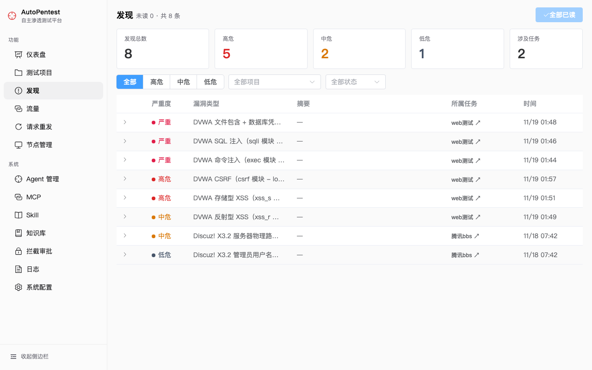
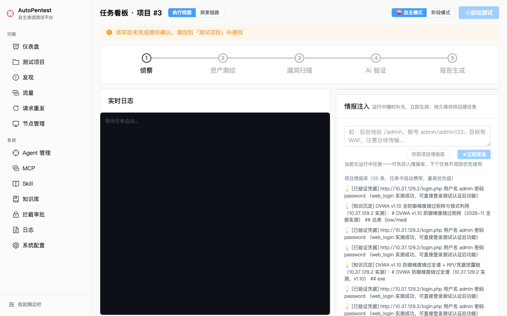
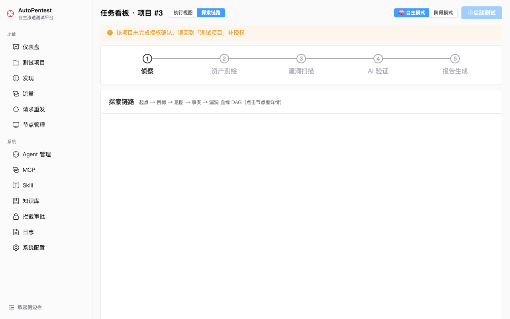
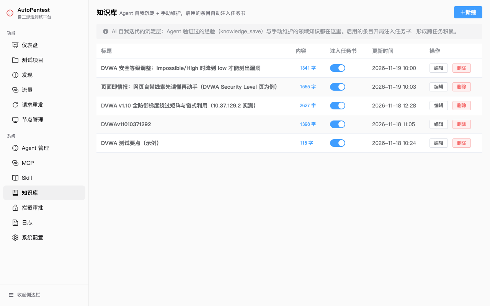

# Argus — Autonomous Pentest Platform (Go)

[中文文档](README.md)

An LLM-Agent-driven web penetration testing platform that autonomously orchestrates the full workflow: **Recon → Asset Mapping → Vulnerability Scanning → AI Verification → Reporting**. Supports attaching a **Kali VM (SSH)** as the pentest execution node, **DNSLog out-of-band detection nodes**, human-in-the-loop collaboration (intel injection + decision-tree visualization), and custom report templates.

> ⚠️ **For use only against targets you have written authorization to test.** The platform enforces a built-in ScopeGuard and full audit logging — every out-of-scope request is forcibly blocked (including IPs/URLs inside commands executed on Kali). Please read the [Disclaimer](#disclaimer) below before using this project.

## Screenshots

| Discoveries: findings with inline evidence (exploit-chain steps + traffic) | Task board: live logs + decision tree + intel injection |
|---|---|
|  |  |

| Exploration graph: start→goal→intent→fact→finding lineage DAG (Vue Flow) | Knowledge base: agent-verified experience, auto-carried into future tasks |
|---|---|
|  |  |

## Quick Start

```bash
./start.sh
# Open http://127.0.0.1:8787
```

1. **Settings** → configure the LLM — one-click presets: **Zhipu Coding Plan** / Zhipu API / **LM Studio local models** / Ollama / OpenAI; local services support "detect models" auto-discovery
2. **Node Management**:
   - **Kali pentest hosts (multi-host)**: fill in SSH connection per host (key-based auth / sudo password / download proxy supported); the UI shows per-host CPU/memory/disk gauges, top processes, and the command the Agent is currently running; the first enabled host is the **primary node** (default execution target); the Agent picks specific hosts via the `host` parameter of `kali_exec`/`kali_install` (different network perspectives / distributed execution), and the available host list is injected into the system prompt automatically
   - **DNSLog node**: ceye.io or a self-hosted compatible API (auto hit-querying), or manual domain mode; the Agent gets `dnslog_payload` / `dnslog_check` tools for blind-injection / SSRF / RCE out-of-band verification
3. **Projects** → create a project: fill in the **authorized scope** (domains / IPs / CIDRs) and confirm authorization
4. Task board → **Start Test**: live logs + **decision tree** (stage → reasoning → tool calls → results, current step highlighted)
5. **Collaborate**: inject intel at any time while a task is running (admin URLs, credentials, bypass ideas…) — the Agent picks it up on its next decision round; otherwise it runs fully autonomously
6. Review results on the Assets / Findings / Reports pages; reports support **custom .md templates** (`{{project_name}}`, `{{findings_table}}`, `{{summary}}` placeholders) with MD/HTML export

## Architecture

```
├── backend/  FastAPI + SQLite
│   └── app/
│       ├── core/    agent (ReAct loop) / pipeline (5 stages) / scope (guardrail)
│       │            llm (OpenAI-compatible) / report / events (SSE) / audit
│       ├── tools/   adapters: subfinder/httpx/nmap/nuclei/katana/sqlmap (detect-only)
│       │            builtin:  port_scan/http_alive/dir_brute/web_crawl/update_finding
│       ├── api/     projects/tasks/assets/findings/settings/stream (SSE)/reports
│       └── models   Project/Task/Asset/Finding/AgentLog/Report
├── frontend/ Vue3 + Vite + Element Plus (served by the backend after build)
└── data/     SQLite · settings.json · directory wordlist (extendable)
```

### Five-Stage Pipeline

| Stage | Scope | Tools |
|---|---|---|
| Recon | Subdomain enumeration, HTTP liveness probing | subfinder → httpx (fallback http_alive) / kali_exec |
| Asset Mapping | Port/service scanning, URL/form crawling | nmap / katana (fallback port_scan / web_crawl) / kali_exec |
| Vulnerability Scanning | POC template scanning, SQL injection detection, sensitive directories, OOB verification | nuclei / sqlmap (detect-only) / dir_brute / kali_exec / dnslog_* |
| AI Verification | Per-finding triage, false-positive removal, benign re-checking | Agent + update_finding / dnslog_check |
| Reporting | Professional pentest report (custom templates supported) | LLM summary (MD/HTML) |

### Safety Guardrails (non-disableable)

- **ScopeGuard**: every outbound tool request is validated against the project's authorized scope (safe suffix matching for domains; IP/CIDR support); anything out of scope is rejected and audited. **kali_exec is equally controlled** — IPv4/URL targets inside commands must pass scope validation, plus a destructive-command blacklist (rm -rf /, mkfs, shutdown, dd to raw devices, fork bombs…)
- **Authorization confirmation**: tasks cannot start until the project authorization box is checked
- **Benign verification**: hard-coded red lines in the Agent system prompt (no destructive operations / data exfiltration / privilege escalation / DoS); the sqlmap adapter is locked to detection mode (`--dump`/`--os-shell` etc. forbidden)
- **Full audit trail**: every Agent reasoning step, tool call and result (including Kali commands), scope rejections, and operator intel are persisted and rendered as the decision tree
- **Rate/step limits**: token-bucket rate limiting, concurrency caps, max Agent steps per stage (configurable)

## Toolchain (executed on Kali + self-deployment)

With a Kali node enabled, **all external tools (subfinder/httpx/nmap/nuclei/katana/sqlmap) run on the Kali host**, with availability probed from Kali in real time; without Kali, execution falls back to the local machine.

**Missing a tool on Kali? The Agent installs it itself**: when a tool is unavailable or returns "command not found", the Agent calls `kali_install` —

| Tool type | Install method |
|---|---|
| subfinder / katana / naabu / nuclei (PD tools) | Official GitHub Release binaries → `~/bin` (proxy + ghfast mirror fallback supported) |
| dirsearch / wafw00f / arjun etc. | pip3 --user |
| Other system packages | apt-get (passwordless sudo or sudo password from the node page) |
| nuclei POC templates | `nuclei-templates` one-shot update |

After installation the toolchain re-registers automatically and the tools are immediately available. The nuclei adapter supports v3 flags (`-j` JSONL).

Built-in fallbacks when external tools are missing: httpx→http_alive, nmap→port_scan, katana→web_crawl; binary paths can also be pinned in Settings → Toolchain Status (remote paths in Kali mode).

## Development Mode

```bash
# Backend on 8787 + frontend hot-reload on 5173 (/api proxy configured)
cd backend && .venv/bin/python run.py &
cd frontend && npm run dev
```

## Disclaimer

**By downloading, installing, running, or using this project in any way, you acknowledge that you have read, understood, and agreed to be bound by all terms of this disclaimer. If you do not agree, stop using and delete this project immediately.**

1. **This project is provided solely for cybersecurity learning, technical research, and security testing within the scope of lawful authorization**, intended to help security professionals improve testing efficiency and defensive capabilities.
2. Users must strictly comply with the **Cybersecurity Law of the People's Republic of China, the Criminal Law of the People's Republic of China (Articles 285, 286, etc.)**, and the laws and regulations of their own country/region. **Scanning, intruding into, or damaging computer information systems without authorization constitutes a criminal offense**, and users bear all legal responsibility for such actions.
3. **All operations performed by users are unrelated to the developers of this project.** The developers shall not be liable for any direct or indirect losses or legal liability arising from abuse, misuse, or illegal use of this project.
4. Before testing with this project, you must obtain **written authorization** from the owner of the target system and confine all testing activities to the authorized scope.
5. This project is provided "as is", without warranty of any kind, express or implied. Users assume all risks of use.
6. If this project involves any infringement or improper use, please contact the developers promptly.

## License

Released under the [MIT License](LICENSE).
